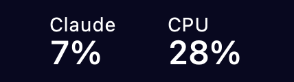

# AIUsageBar

A tiny macOS menu bar app that shows how much of your **Claude 5-hour usage limit** you have used, styled like the two-line indicators of [Stats](https://github.com/exelban/stats).



*Rendered mock-up: the Claude tile next to a Stats-style CPU tile.*

- **No extra login.** It reuses the session of the Claude desktop app you are already signed in to.
- **Only there when you need it.** The indicator appears while a Claude window is open (minimised, hidden or on another Space counts too) and disappears when you close it. This can be turned off.
- **Click for details:** 5-hour and 7-day usage with reset times, refresh, link to claude.ai usage, launch at login.
- **Native and light.** One Swift file, Apple frameworks only, no dependencies. Menu in English or German, following your system language.

## Requirements

- macOS 14 or later (built and tested on macOS 27, Apple Silicon)
- The [Claude desktop app](https://claude.ai/download), signed in
- For building: Xcode Command Line Tools (`xcode-select --install`)

## Install

### Download

Grab `AIUsageBar.zip` from [Releases](../../releases), unzip it and move `AIUsageBar.app` to `/Applications`.

The app is not notarized by Apple, so on first launch macOS will block it as unverified. Open **System Settings → Privacy & Security**, scroll down and click **Open Anyway** next to AIUsageBar (on older macOS: right-click the app and choose **Open**). Or build it yourself (below), which avoids the warning.

### Build from source

```bash
git clone https://github.com/hsxcix/AIUsageBar.git
cd AIUsageBar
./build.sh
```

This compiles `main.swift`, creates `AIUsageBar.app` in the same folder, signs it ad hoc and starts it. New menu bar items appear on the left; hold ⌘ and drag to move it.

## How it works (please read)

AIUsageBar does **not** ask for your password or have its own login. Instead it borrows the token the Claude desktop app has already stored:

1. The Claude desktop app (Electron) keeps its OAuth tokens in `~/Library/Application Support/Claude/config.json`, encrypted with Electron's `safeStorage`.
2. AIUsageBar reads the decryption password from the macOS keychain item **"Claude Safe Storage"** using Apple's `/usr/bin/security` tool. macOS may ask you once to allow this.
3. It decrypts the token locally (PBKDF2 + AES-128-CBC, the standard Chromium scheme) and calls `https://api.anthropic.com/api/oauth/usage`, the same endpoint Claude Code's `/usage` command uses.
4. It **never refreshes** the token, because that would invalidate the desktop app's copy. The desktop app keeps it fresh while it is running.

The token is only held in memory and only sent to `api.anthropic.com`. There is no analytics, no other network traffic, and nothing is written to disk except the app's own preferences.

**Caveats:** the usage endpoint and the desktop app's storage format are not public APIs. Anthropic can change either at any time, which would break this app until it is updated. This project is not affiliated with or endorsed by Anthropic.

## Adding other services

Each service is a `UsageProvider` (see `main.swift`). To add one, implement the protocol and append it to `providers` in `AppDelegate`; it gets its own tile in the menu bar and its own toggle in the menu.

## License

**All rights reserved**, provided as is without any warranty. See [LICENSE](LICENSE).

In practice I don't really mind if you use it. I just keep all rights and decide case by case. If you want explicit permission (for example to fork, redistribute or build on it), open an issue or contact me on GitHub.
